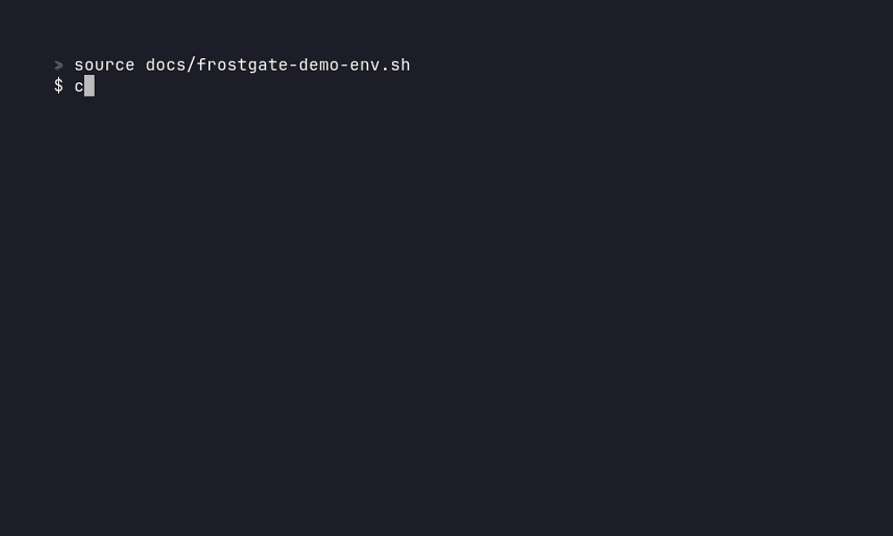

# Frostgate

Frostgate checks proxy routes, measures latency and throughput, diagnoses failures, and recommends a working route.

It supports Frostgate-managed VLESS + REALITY over RAW/TCP, including Vision, and Hysteria2 through sing-box. It runs locally and stores its configuration and history on the local machine.



## Quick start

```sh
curl -fsSL https://raw.githubusercontent.com/ilyasmohaimel/frostgate/main/install.sh | sh
frostgate setup
frostgate
frostgate benchmark
```

`frostgate` performs bounded health checks. `frostgate benchmark` also measures download throughput for each usable proxy route.

## Install

```sh
curl -fsSL https://raw.githubusercontent.com/ilyasmohaimel/frostgate/main/install.sh | sh
frostgate --version
```

The installer places the binary in `~/.local/bin` by default. Linux `amd64` and `arm64` use static release binaries; other platforms use `go install` when Go is available.

Release downloads fail closed: the installer requires `SHA256SUMS`, verifies the checksum, and runs `--version` before replacing an existing binary. It never installs proxy configuration or credentials.

```sh
go install github.com/ilyasmohaimel/frostgate/cmd/frostgate@latest
```

If `go install @latest` fails immediately after a release, wait for the module proxy to index the tag. Do not disable Go checksum verification.

If the binary is not on `PATH`:

```sh
# bash/zsh
export PATH="$HOME/.local/bin:$PATH"

# fish
fish_add_path ~/.local/bin
```

## Shell completion

The installer writes completion for the detected shell when its user completion directory is safe to use. Fish is installed at `~/.config/fish/completions/frostgate.fish` by default.

Generate scripts manually when needed:

```sh
frostgate completion fish > ~/.config/fish/completions/frostgate.fish
frostgate completion bash > ~/.local/share/bash-completion/completions/frostgate
frostgate completion zsh > ~/.local/share/zsh/site-functions/_frostgate
```

Supported shells are Fish, Bash, and Zsh. Completion reads no network state.

## Commands

| Command | Purpose |
| --- | --- |
| `frostgate` | Probe configured routes. |
| `frostgate setup` | Create or update local configuration. |
| `frostgate add <link>` | Add one VLESS or Hysteria2 route. |
| `frostgate import <url>` | Import a subscription once. |
| `frostgate test <link>` | Test a route without saving it. |
| `frostgate benchmark` | Measure route health and download speed. |
| `frostgate diagnose [route]` | Diagnose route failures. |
| `frostgate network-check` | Check local network signals. |
| `frostgate compare` | Compare recorded network labels. |
| `frostgate recommend` | Show the recommended route. |
| `frostgate history` | Show local history. |
| `frostgate doctor` | Check local setup. |

Run `frostgate --help` for command flags.

## Exit status and failures

For commands that report route health (`frostgate`, `import` post-import checks, and `benchmark`):

| Exit | Meaning |
| --- | --- |
| `0` | Success: all relevant routes are healthy. |
| `1` | Degraded or mixed result. |
| `2` | All relevant routes are down. |
| `3` | Configuration, validation, command, or other operational error. |

Malformed config or invalid endpoint settings return `3`. A controller that is unreachable or unauthorized, a missing outbound, or a stopped managed sidecar makes the affected proxy route down, contributing to `1` or `2`. Setup/import candidate validation or transaction failures return `3`. Benchmark selector capture, switch, or restoration failures also return `3`, even when latency probes are healthy.

## Add and import routes

Quote share links because query strings contain shell-special characters:

```sh
frostgate add 'vless://YOUR_LINK'
frostgate add --name backup 'hysteria2://YOUR_LINK'
frostgate test 'vless://YOUR_LINK'
frostgate import 'https://provider.example/subscription'
```

Imports accept plain or base64 subscriptions, Clash YAML, and supported sing-box JSON. HTTP subscriptions require an explicit opt-in:

```sh
frostgate import --allow-insecure-http 'http://provider.example/subscription'
```

Routes are validated, deduplicated by fingerprint, and written through the managed sing-box transaction. Frostgate validates the candidate with `sing-box check`, restarts only the profile's managed sidecar service, checks the controller and expected outbounds, and rolls back on failure.

Raw share and subscription URLs are never printed. Keep `~/.config/frostgate/` private.

### Supported protocol scope

- VLESS + REALITY over RAW/TCP; Vision (`xtls-rprx-vision`) is supported.
- Native sing-box RAW VLESS has no V2Ray `transport` object. An omitted native `network` keeps sing-box's TCP-and-UDP default; explicit native TCP is preserved as `network: tcp`.
- Hysteria2 with password, SNI, salamander obfs, obfs password, and `tls.insecure`.
- VLESS `ws`, `grpc`, `http`, `httpupgrade`, `quic`, and `kcp` transports are rejected.
- Certificate pinning fields are rejected for VLESS and Hysteria2 because Frostgate cannot preserve them safely.
- Trojan, Shadowsocks, VMess, and unsupported subscription nodes are reported as unsupported.

## Benchmark

```sh
frostgate benchmark
frostgate benchmark --no-speed
frostgate benchmark --network home
```

The default download is 8 MiB per usable outbound from `https://speed.cloudflare.com/__down`. Approximate traffic is `benchmark.download_bytes × (unique usable outbounds + non-proxy endpoints)`. Use `--no-speed` on metered connections.

Example:

```text
FROSTGATE BENCHMARK
Direct baseline: UP 23ms
ROUTE                STATUS   LOSS  MEDIAN  JITTER   DOWNLOAD
direct-baseline      up         0%    23ms    12ms N/A (direct baseline)
backup-hysteria2     up         0%   355ms    37ms 84 Mbps
primary-reality      up         0%   460ms   206ms 61 Mbps

Best proxy: backup-hysteria2
Why: 0% loss - 355ms median - 84 Mbps
Preferred: primary-reality
```

For Frostgate-managed sidecars, proxy downloads use the managed loopback listener and `frostgate-selector`. Existing managed configurations without `singbox.benchmark_proxy` are discovered from the sidecar. Older Frostgate sidecars without the selector/listener are migrated transactionally when their managed structure can be verified. Frostgate reads the active selector before a benchmark and restores it afterwards; if the selector state cannot be read, it does not switch routes.

An external or unmanaged controller is never assigned a guessed listener. Without a proven loopback `singbox.benchmark_proxy`, proxy throughput remains `N/A`.

## Diagnose and network checks

```sh
frostgate diagnose
frostgate diagnose primary-reality
frostgate network-check
```

Diagnosis checks direct connectivity, DNS, measured VLESS TCP reachability, sidecar/controller state, and an end-to-end proxy request. Hysteria2 uses the end-to-end request as its authority; Frostgate does not claim independent low-level UDP or QUIC reachability.

`network-check` runs configured destinations through direct and proxy paths without changing the selector. DNS and DoH results are reported as:

- `MATCH`: address sets agree.
- `DIFFER`: address sets differ.
- `UNAVAILABLE`: one source could not be queried.

`DIFFER` is a signal only, not proof of DNS poisoning or censorship. CDNs and geographically distributed resolvers can return different addresses.

With no sing-box endpoints, `doctor` and `diagnose` mark sing-box, sidecar, and controller checks as `SKIP`; direct connectivity and DNS checks still run.

## History, comparison, and recommendations

```sh
frostgate benchmark --network home
frostgate benchmark --network mobile
frostgate compare
frostgate history --since 7d --config /path/to/config.yaml
frostgate compare --config /path/to/config.yaml
frostgate recommend --config /path/to/config.yaml
```

`Direct baseline` is a non-proxy connectivity reference. It does not compete for `Best proxy`.

Recommendations rank health, loss, historical availability, throughput, latency, jitter, and priority. Priority only resolves close candidates; a materially better route wins. A down route is never recommended.

History is stored at `$XDG_DATA_HOME/frostgate/history.db` or `~/.local/share/frostgate/history.db`. It contains measurements and error categories, not route credentials or URLs. New records are scoped to the selected config profile, so equal route names in separate profiles do not share recommendation evidence. Existing unscoped records remain visible to the default profile.

## Configuration

Most users should use `frostgate setup`, `add`, or `import`. The generated config is at `$XDG_CONFIG_HOME/frostgate/config.yaml` or `~/.config/frostgate/config.yaml`.

An explicit `--config /path/to/config.yaml` is an isolated profile. Its managed state is the hidden sibling `.frostgate-<profile-id>/`, keyed by the canonical config file. Two configs in one directory stay separate; relative and symlink aliases of one config share one profile. The default config keeps its historical XDG paths, service, and ports. Custom profiles use deterministic service and loopback bindings.

Legacy custom state beside an explicit config is adopted only when its config, routes, controller, listener, and secret prove ownership. If a legacy unit exists, it must point at that state before Frostgate quiesces it. Ambiguous legacy state is left untouched.

A Frostgate config supports up to 32 endpoints. This is an intentional supported limit. Config validation rejects 33 or more endpoints before probing or managed changes, with an error such as `too many endpoints: 33 configured, maximum is 32`.

```yaml
defaults:
  timeout: 5s
  samples: 4
  sample_interval: 150ms
  healthy_latency: 800ms
  max_jitter: 80ms
  max_loss: 0

singbox:
  controller: http://127.0.0.1:9090
  secret_file: ~/.config/frostgate/controller-secret
  test_url: https://www.gstatic.com/generate_204
  benchmark_proxy: 127.0.0.1:2080

benchmark:
  download_url: https://speed.cloudflare.com/__down
  download_bytes: 8388608

history:
  enabled: true
  retention: 90d
  watch_interval: 5m

network_check:
  destinations:
    - name: github
      url: https://github.com/

endpoints:
  - name: direct
    type: http
    url: https://www.gstatic.com/generate_204
    expected_status: 204
    priority: 100
  - name: primary-reality
    type: singbox
    outbound: primary-reality
    priority: 10
```

`max_loss` is authoritative for partial loss from 0 to 100. A route is DOWN for loss only when every sample fails.

When a controller secret is configured, plaintext `http://` controllers are allowed only on loopback (`127.0.0.0/8`, `::1`, or `localhost`). Use HTTPS or a local tunnel for remote controllers.

`benchmark.download_url` must be HTTP or HTTPS. Frostgate appends the configured byte count to its `bytes` query parameter. `singbox.benchmark_proxy` must be a loopback `host:port` and belongs to the managed sidecar; omit it for an external controller that has no proven benchmark listener.

`defaults.priority` is inherited only by endpoints that omit `priority`; an explicit `priority: 0` remains zero. `defaults.degraded_latency` is rejected because it has no health-policy effect.

Set `history.enabled: false` for zero history database access. `history.retention` controls pruning. `history.watch_interval` limits writes while watching.

For HTTP endpoints, `expected_status` requires an exact response code. Without it, any HTTP status from 200 through 399 is considered successful.

## JSON

```sh
frostgate --json
frostgate --watch --json
frostgate benchmark --json
frostgate diagnose --json
frostgate network-check --json
frostgate compare --json
frostgate recommend --json
frostgate history --json
```

Core probe documents use JSON schema version 4. They include `direct`, `best_proxy`, and classifier `reasons`; unknown jitter is `null` with `jitter_known: false`. The legacy `best` field remains where applicable. Watch mode writes one JSON document per line. Human messages go to stderr in JSON mode.

## Sidecar and recovery

The managed sidecar listens on loopback only. For the default profile, check it with:

```sh
frostgate --doctor
sing-box check -c ~/.config/frostgate/sing-box.json
systemctl --user status frostgate-singbox.service --no-pager
```

For a custom profile, use `frostgate doctor --config /path/to/config.yaml`; it reports that profile's service.

`frostgate setup` preserves an existing configuration unless you choose reconfigure or reset. Reconfigure creates `backup-<timestamp>` in the Frostgate configuration directory.

## Security notes

- Share URLs, subscription URLs, controller secrets, UUIDs, REALITY material, and Hysteria passwords are credentials.
- Frostgate stores route credentials only in private local configuration files with mode `0600`.
- Frostgate redacts errors, verbose/debug output, JSON output, history, TUI output, and test data before printing or storing them. Share links and subscription URLs passed on the command line may remain in shell history or the local process list while Frostgate runs.
- Temporary `frostgate test` configurations use a private temporary directory and are removed on exit.
- The repository ignores root-level local Frostgate files such as `config.yaml`, `sing-box.json`, `controller-secret`, `history.db`, and `dist/`. Custom profiles can live anywhere, so do not commit private configuration directories.

## Limitations

- Frostgate tests routes; it does not route normal device traffic.
- Speed depends on the target and current network conditions.
- Only Linux `amd64` and `arm64` release binaries are published.
- Automatic failover and push alerts are not available.

## Development

```sh
make check
make dist
go test -race ./...
sh scripts/test-install.sh
```

The README GIF is generated from a local fixture with no proxy credentials. With VHS, `ttyd`, Go, and Python 3 on `PATH`:

```sh
PATH="$PWD/docs/demo-bin:$PATH" vhs docs/frostgate-demo.tape
```

## License

[MIT](./LICENSE) © Ilyas Mohaimel
